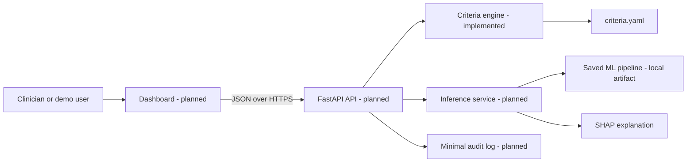
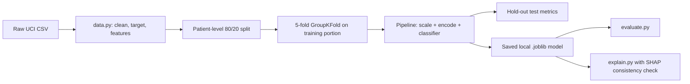
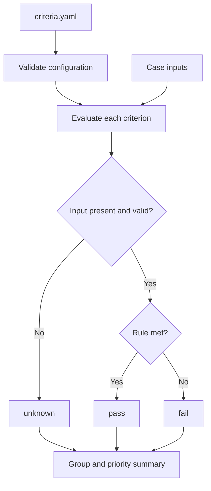

# Discharge Readiness Support System — System Design

Status: prototype design | Last updated: 2026-10-17

## 1. Purpose and scope

This academic prototype supports discharge planning through two separate views of the same case:

1. A rule-based clinical and discharge-transition checklist.
2. An explained ML estimate of historic facility-care discharge likelihood.

The treating clinician remains responsible for every discharge decision. The system does not diagnose, prescribe treatment, or declare a patient "ready" for discharge.

The ML result is deliberately not called a readiness score. Public training data has no true discharge-readiness label; it records discharge destination. The ML component is therefore a retrospective, research-only proxy for facility-care discharge in its training population.

### In scope

- A configurable 13-item criteria checklist with `pass`, `fail`, and `unknown` results.
- Offline ML training, evaluation, and SHAP explanations using the UCI Diabetes 130-US Hospitals dataset.
- A future local-demo API and dashboard that show both views without merging them into one score.

### Out of scope

- Autonomous discharge approval or treatment advice.
- Clinical deployment, real patient data, EMR/HIS integration, or prospective validation.
- A claim that the current ML model works for all diagnoses or all hospitals.

## 2. Current implementation status

| Component | Status | Evidence |
|---|---|---|
| Criteria engine | Implemented and tested | `criteria/engine.py`, `criteria/tests/` |
| Criteria definitions and evidence | Implemented | `criteria/criteria.yaml`, `docs/criteria_evidence.md` |
| ML data preparation and training | Implemented | `ml/src/data.py`, `ml/src/train.py` |
| Evaluation and SHAP explanations | Implemented offline | `ml/src/evaluate.py`, `ml/src/explain.py` |
| ML and criteria CI | Implemented | `.github/workflows/` |
| Backend API | Planned | `backend/` is a placeholder only |
| Frontend dashboard | Planned | `frontend/` is a placeholder only |
| Docker/local integrated demo | Planned | Not yet implemented |

## 3. Architecture

The repository is a monorepo: criteria, ML, backend, frontend, and documentation stay in one Git repository. The future frontend and backend run as separate applications, but share one versioned codebase and one API contract.

## 4. Functional requirements

| ID | Requirement | Status |
|---|---|---|
| F1 | Evaluate each configured criterion as pass, fail, or unknown | Implemented |
| F2 | Never treat missing clinical input as pass | Implemented |
| F3 | Return grouped counts and priority unmet/unknown items | Implemented |
| F4 | Train a facility-vs-home proxy model with patient-level splitting | Implemented offline |
| F5 | Return an ML probability with top explanation factors | Implemented offline |
| F6 | Provide a combined case-review API without a merged readiness score | Planned |
| F7 | Show a disclaimer on every API/dashboard response | Planned |
| F8 | Log only minimised, non-identifying demo data | Planned |

## 5. Data and ML design

### 5.1 Dataset and intended population

The ML work uses the UCI Diabetes 130-US Hospitals dataset: diabetic inpatient encounters from 130 US hospitals, collected from 1999 to 2008. It has no true discharge-readiness label, detailed time-stamped observations, or numeric vital-sign series.

The current ML model must be described as a **research-only facility-care discharge proxy for this diabetic inpatient dataset**. It is not validated for all patients, Pakistani hospitals, or real clinical decision-making.

Raw data, trained model files, virtual environments, secrets, and patient-like records are intentionally excluded from Git.

### 5.2 Target definitions

| Target | Definition | Role |
|---|---|---|
| Facility vs home | Home IDs: 1, 6, 8. Facility IDs: 2, 3, 4, 5, 22, 23, 24, 30. Expired, hospice, and other destinations are excluded. | Primary research proxy |
| Readmission within 30 days | UCI `readmitted == "<30"`; expired/hospice encounters excluded. | Secondary exploratory model |

The facility grouping is a project-defined proxy and must not be described as a direct measurement of discharge readiness or care need.

### 5.3 Feature preparation and leakage controls

`ml/src/data.py`:

- Removes identifiers: `encounter_id` and `patient_nbr`.
- Removes outcome fields: `discharge_disposition_id` and `readmitted`.
- Drops mostly-missing `weight`; converts age bins to numeric midpoints.
- Groups ICD-9 diagnosis codes into broad categories.
- Replaces missing categorical values with `Not_measured`.
- Excludes `time_in_hospital` from the facility target because it may be influenced by the disposition process.

The model is framed as a retrospective proxy. Encounter-level counts may represent information accumulated during the stay; this dataset does not prove their availability at a fixed point before discharge.

### 5.4 Training protocol

Patients, not rows, are split with `GroupShuffleSplit` and `GroupKFold`; seed 42 prevents accidental train/test patient overlap. The pipeline uses `StandardScaler` for numeric columns and `OneHotEncoder` for categorical columns. Logistic Regression is the interpretable baseline; XGBoost is the primary tabular-data model (200 trees, depth 4, learning rate 0.05).

### 5.5 Current reference results

| Target | Model | Hold-out AUC | PR-AUC | Brier score |
|---|---|---:|---:|---:|
| Facility vs home | XGBoost | 0.799 | 0.547 | 0.132 |
| Facility vs home | Logistic Regression | 0.792 | 0.533 | 0.186 |
| Readmission <30 days | XGBoost | 0.648 | 0.207 | 0.096 |
| Readmission <30 days | Logistic Regression | 0.644 | 0.199 | 0.231 |

Primary-model five-fold CV AUC is approximately 0.799 with standard deviation approximately 0.004. The readmission model is exploratory and should not be central to the demonstration.

XGBoost explanations use TreeSHAP. The code transforms data once and supplies the same sparse matrix to the model and SHAP explainer. It fails if reconstructed SHAP probabilities disagree with pipeline probabilities beyond the configured tolerance.

## 6. Criteria engine

The criteria engine is independent from ML. It evaluates clinician-entered or demo-case values against YAML rules.

The 13 criteria cover clinical stability, A1C availability, and discharge-transition planning. Threshold sources and adaptation limits are documented in `docs/criteria_evidence.md`.

Design rules:

1. Missing or invalid input is `unknown`, never `pass`.
2. Each criterion has a source, group, input type, severity, and rule in YAML.
3. Output presents item status and priorities; it never produces a single "ready/not ready" score.
4. The criteria are adapted research rules, not a clinically validated universal discharge protocol.

## 7. Planned API and integration contract

Before prediction endpoints, add an inference service that loads the saved pipeline, validates exact raw model inputs, predicts, and produces explanation factors. The API request contract must be derived from raw trained-model features; the frontend must not invent or drift from that schema.

| Endpoint | Purpose | Status |
|---|---|---|
| `GET /v1/health` | Return service/model/criteria status | Planned |
| `POST /v1/assess` | Evaluate criteria inputs | Planned |
| `POST /v1/predict` | Return ML proxy probability and factors | Planned |
| `POST /v1/review` | Return both views and a review prompt | Planned |

`/review` may flag disagreement but must not merge outputs into a readiness score. Any probability threshold used for a higher/lower category is a documented research/demo operating point, not a clinical discharge threshold.

## 8. Security, privacy, and reliability

- No real patient data is authorised for this academic prototype.
- Do not commit datasets, `.joblib` models, `.env` files, tokens, keys, or virtual environments.
- A future API must validate input, reject unexpected fields, use an environment-based API key, limit CORS to approved origins, and apply rate limits.
- Future logs must exclude identifiers and minimise retained input. A free-text `case_id` or full raw patient record must not be logged by default.
- GitHub access must use secure authentication (SSH or `gh auth login`); any exposed plaintext token must be revoked.

## 9. Testing and delivery

Existing checks cover criteria rules, configuration validation, target construction, and basic leakage exclusions. CI also blocks tracked data/model/credential files and notebook outputs.

Before declaring an integrated system complete, add inference tests, API/integration tests for three reproducible demo cases, model metadata, bootstrap confidence intervals, target sensitivity analysis, and documented calibration review.

## 10. Key decisions and limitations

| Decision | Reason |
|---|---|
| Keep criteria and ML separate | No public readiness label supports a validated merged score. |
| Use config-driven criteria | Rule changes should not require code changes. |
| Use patient-level splits | Prevent patient leakage across train/test sets. |
| Save preprocessing with the classifier | Avoid training-serving transformation drift. |
| Use SHAP with a consistency guard | Do not show explanations that fail to reproduce model output. |
| Use a monorepo | Criteria, ML, backend, frontend, and docs are tightly coupled. |
| Build contract-first backend | API input must match trained-model input. |

Current limitations: diabetic patients only; US data from 1999–2008; no true readiness label; no detailed numeric vitals; high missingness in some measurements; a project-defined facility target; no external/prospective clinical validation; and potential influence of demographic, payer, and hospital-practice patterns.

Future work includes clinician review, governed local data, external/prospective validation, uncertainty reporting, drift monitoring, and HIS/FHIR integration after ethics and security review.
