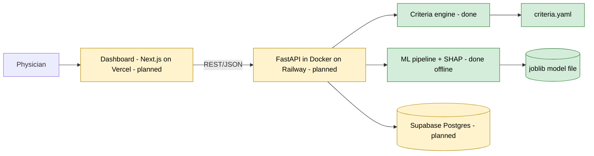
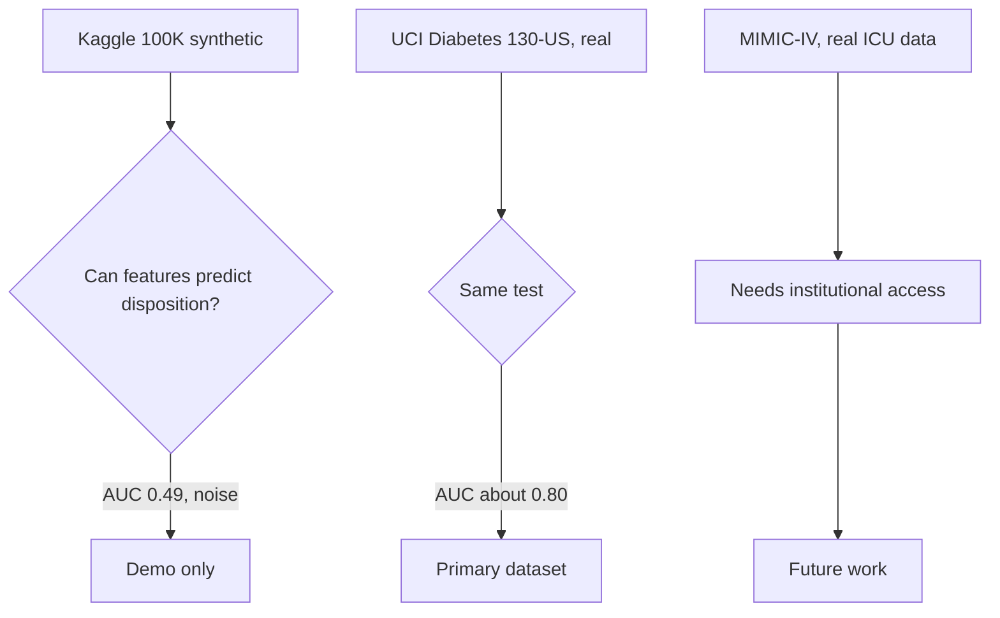
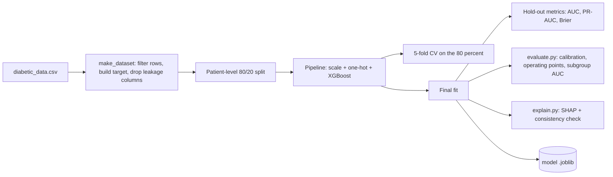
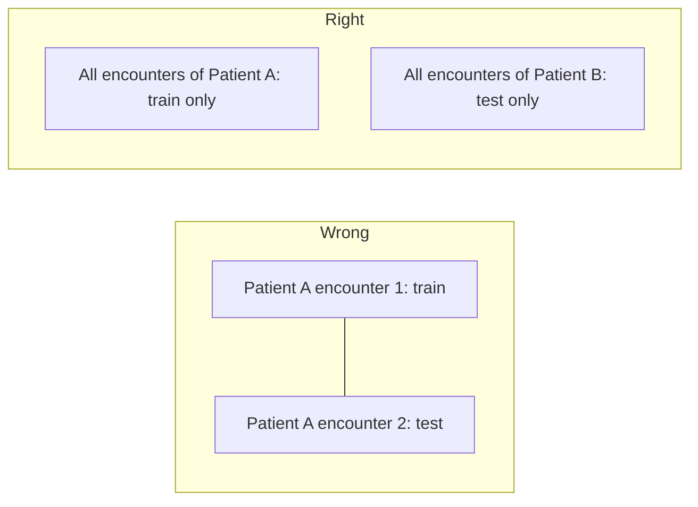
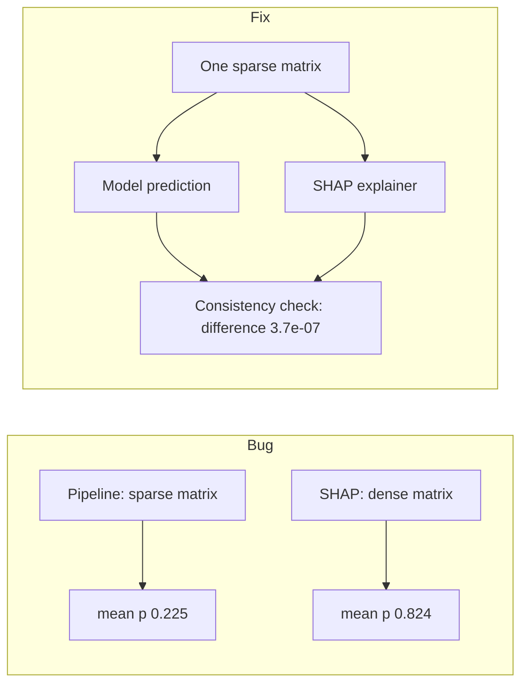
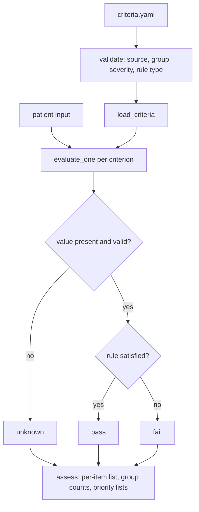
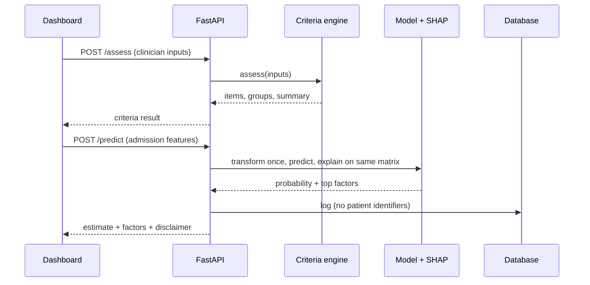
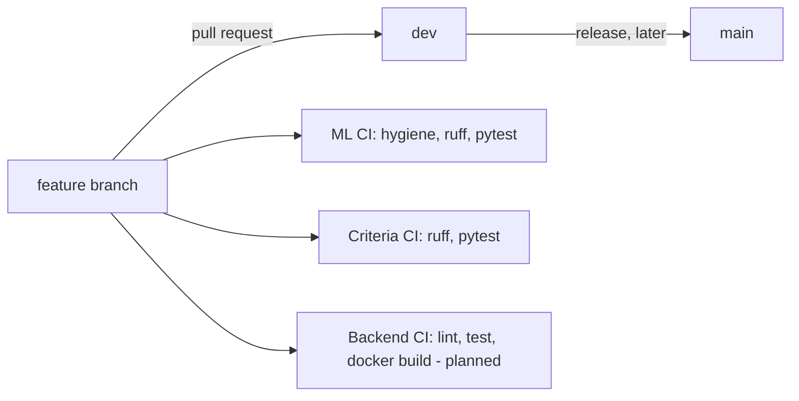

# System Design

Status: DRAFT v0.2 | Last updated: 2026-10-11

Legend: **[done]** exists in the repo and is tested. **[planned]** not built yet.

## 1. Purpose of this document
This document explains how the system is built and why. It is written so that a teammate who did
not write the code can follow it. Section 12 is a glossary of technical terms.

## 2. System overview
The tool gives a physician two separate views of the same discharge decision:
1. A **criteria checklist** (rule-based, from published guidelines).
2. An **ML estimate** of whether the patient will need facility care after discharge.

They are kept separate on purpose. We never merge them into one "readiness score", because no
public dataset provides a readiness label and a combined number would overclaim.

## 3. Repository layout
| Path | Contents | Status |
|---|---|---|
| ml/notebooks | Data audit and signal tests (01 Kaggle, 02 UCI) | [done] |
| ml/src | data.py, train.py, evaluate.py, explain.py | [done] |
| ml/tests | Tests for target building and leakage columns | [done] |
| ml/reports | Metrics, evaluation and SHAP outputs (JSON, one PNG) | [done] |
| criteria | criteria.yaml, engine.py, tests | [done] |
| .github/workflows | ml-ci.yml, criteria-ci.yml | [done] |
| docs | Evidence table, this document | [done] |
| backend | FastAPI app, Dockerfile | [planned] |
| frontend | Dashboard | [planned] |

Gitignored by design: raw data (ml/data), trained models (*.joblib), virtual environments, .env files.

## 4. Data and dataset decision
We tested two datasets with a quick signal test before building anything.

| Dataset | Result | Decision |
|---|---|---|
| Kaggle 100K (synthetic) | home vs non-home AUC 0.49; readmission 0.60; vitals and labs not linked to admission time | Demo only |
| UCI Diabetes 130-US (101,766 encounters, 71,518 patients, CC BY 4.0) | facility vs home AUC about 0.80; readmission AUC about 0.65 | Primary |
| MIMIC-IV | requires credentialed access | Future work |

## 5. ML design

### 5.1 Targets
- **Primary: facility care vs home.** Home = discharge IDs 1, 6, 8. Facility = 2, 3, 4, 5, 22, 23, 24, 30.
  Expired, hospice and unknown IDs are excluded. This grouping is our own choice and must be justified
  in the proposal.
- **Secondary: readmitted within 30 days.** Expired and hospice excluded.
- We call it "post-discharge care-need assessment", not "readiness", because the data has no label for
  "was the patient ready".

### 5.2 Training flow

Feature preparation (src/data.py): diagnosis codes grouped into ICD-9 categories, age bins converted
to the bin midpoint, weight dropped (97% missing), missing categorical values labelled "Not_measured".
Model (src/train.py): StandardScaler for numbers, OneHotEncoder for categories, XGBoost
(200 trees, depth 4, learning rate 0.05). Logistic regression is kept as an interpretable baseline.

### 5.3 Why the split is by patient
One patient can have several encounters. If the same patient appears in both train and test, the
model has seen them before and the score is inflated.

We use GroupShuffleSplit (80/20) and GroupKFold(5) grouped by patient_nbr, seed 42.

### 5.4 Leakage control
Information that is only known after discharge must not be a feature.
- Length of stay is dropped for the facility target (it is itself an outcome).
- Test: removing the stay counts (medications, labs, diagnoses, procedures) gave AUC 0.781 versus
  0.796, so the signal does not come from leakage through those columns.
- ml/tests/test_data.py checks that discharge_disposition_id, readmitted, time_in_hospital,
  encounter_id, patient_nbr and age are not in the features.

### 5.5 Results
| Target | Model | Test AUC | PR-AUC | Brier |
|---|---|---|---|---|
| Facility vs home | XGBoost | 0.799 | 0.547 | 0.132 |
| Facility vs home | LogReg (baseline) | 0.792 | 0.533 | 0.186 |
| Readmit <30 days | XGBoost | 0.648 | 0.207 | 0.096 |
| Readmit <30 days | LogReg | 0.644 | 0.199 | 0.231 |

How to read this:
- A model that only knows age, payer and admission source already gets AUC 0.728. The full model
  adds about 0.06. The signal is mostly age and insurance, and we report that openly.
- XGBoost is well calibrated: when it says about 60%, about 65% of those patients really went to
  a facility (top decile: predicted 0.602, observed 0.650).
- LogReg probabilities are poor (balanced class weights inflate them), so LogReg is a baseline only.
- Flagging the 20% highest-risk patients gives precision 0.53, recall 0.49, lift 2.5 (base rate 22%).
- Subgroup AUC: female 0.811 vs male 0.780; race groups 0.797 to 0.798 (Hispanic 0.737 but only
  379 patients, so no conclusion); age bands 0.719 to 0.767, weakest for 80+.
- The readmission model is weak but calibrated and is shown with that caveat.

### 5.6 Explainability and the bug we fixed
SHAP shows which factors pushed one prediction up or down. Our first version converted the data to a
dense matrix. XGBoost treated the same data differently (dense vs sparse), so SHAP explained an input
the model never saw in training (mean probability 0.824 vs the pipeline's 0.225).

explain.py now crashes if SHAP does not reproduce the pipeline's own probabilities. The same rule
applies in the future /predict endpoint: transform once, give the same matrix to both.

## 6. Criteria engine design

### 6.1 What it does
Takes the values a clinician enters and returns a status per criterion. No ML is involved.

### 6.2 The 13 criteria
| Group | IDs | Source | Input |
|---|---|---|---|
| Clinical stability (7 factors) | C1 to C7: temperature, heart rate, respiratory rate, systolic BP, SpO2, oral intake, mental status | Halm 2002 | Clinician |
| Diabetes care | C8: A1C result available | ADA Standards of Care 2026, Rec. 16.1 | Data |
| Discharge transition | C9 discharge plan, C10 medication reconciliation, C11 follow-up scheduled, C12 pending-results plan, C13 services/equipment | ADA 2026 Rec. 16.18 and AHRQ RED Toolkit | Clinician |

### 6.3 Design rules
1. **Missing means unknown, never pass.**
2. **No single readiness score.** The output is counts per group plus lists of priority items that
   are not met or unknown.
3. **Severity is "priority" or "advisory", not "blocking".** Halm leaves a single instability to the
   clinician; two or more usually means the patient stays.
4. **Every criterion carries a source citation**, enforced by validation and a test.
5. **Rules live in criteria.yaml.** If the supervisor or a clinician changes a threshold, only the
   YAML file changes.
6. **Thresholds come from a pneumonia cohort** and are adapted, not validated for diabetic patients.
   Halm's results: 10.5% / 13.7% / 46.2% of patients with 0 / 1 / 2 or more instabilities died or were
   readmitted within 30 days; "no instability" does not mean safe (sensitivity of 1 or more was 27.5%).

## 7. API design [planned]
| Endpoint | Input | Output |
|---|---|---|
| GET /health | none | status, criteria_version |
| POST /assess | clinician fields, all optional, extra fields rejected | criteria_version, disclaimer, summary, groups, items |
| POST /predict | raw admission features (validated) | probability, top factors, model_version, disclaimer |

## 8. Data model [planned]
prediction_logs: id, created_at, endpoint, input_hash, features (jsonb, no identifiers), output (jsonb),
latency_ms, model_version, criteria_version, override_reason (nullable).
Reason for jsonb: the UCI features differ from the earlier vitals-based schema idea, and criteria
inputs will change as the supervisor gives feedback.

## 9. CI/CD and environments

- ML CI and Criteria CI [done], both green on dev.
- ML CI hygiene job fails if any .csv, .joblib, .pkl, .pem, .key or .env file is tracked, or if a notebook
  has stored outputs.
- Python 3.12 is used locally, in CI and in Docker. Pickled models can fail across Python versions.
- Deploy [planned]: Railway (API), Vercel (frontend), Supabase (database). Secrets only in GitHub and
  Railway variables.
- On a free-org private repo, branch protection is not enforced, so green CI before merge is a team rule.

## 10. Security and privacy
- Public datasets only. No real patient data enters the system. No identifiers in logs.
- Known weakness: the GitHub token is stored in plain text. Plan: move to SSH or gh auth.
- This is an academic prototype, not a clinical tool. Every response carries a disclaimer.

## 11. Design decisions
| # | Decision | Reason |
|---|---|---|
| 1 | Real UCI data, not synthetic Kaggle | Signal test showed none in synthetic data |
| 2 | "Care-need" framing | No public readiness label exists |
| 3 | Criteria in config | Supervisor replies slowly; changes must be cheap |
| 4 | Criteria and ML kept separate | Avoid an unvalidated combined score |
| 5 | One Pipeline artifact | Prevent training-serving skew |
| 6 | SHAP on the model's own matrix, with a check | Earlier version explained the wrong input |
| 7 | Python 3.12 everywhere | Avoid pickle incompatibility |
| 8 | Patient-level split | Prevent inflated scores |

## 12. Limitations
Diabetic patients only; 1999-2008 US data; A1C about 83% and glucose about 95% missing; ML data has no
vitals or labs, so stability is judged by the criteria layer; the signal is mostly age and Medicare;
the home/facility grouping is our own; Hispanic subgroup is small; criteria are not clinician-reviewed;
no real-world validation.

## 13. Glossary
- **AUC**: how well the model ranks patients who had the outcome above those who did not. 0.5 is a coin
  flip, 1.0 is perfect.
- **PR-AUC**: like AUC but more informative when the outcome is rare.
- **Brier score**: how close predicted probabilities are to what happened. Lower is better.
- **Calibration**: when the model says 60%, about 60% should really happen.
- **Leakage**: a feature that reveals the answer because it is only known after the outcome.
- **SHAP**: shows how much each feature pushed one prediction up or down.
- **Pipeline**: preprocessing and model saved as one object, so serving repeats exactly what training did.
- **CI**: automatic checks that run on every pull request.
- **Pull request (PR)**: a proposal to merge a branch, reviewed before it enters dev.
